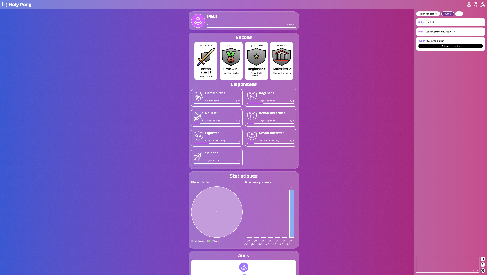
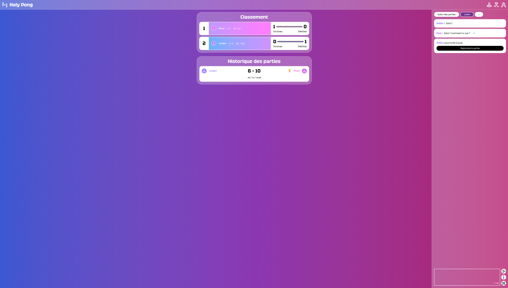
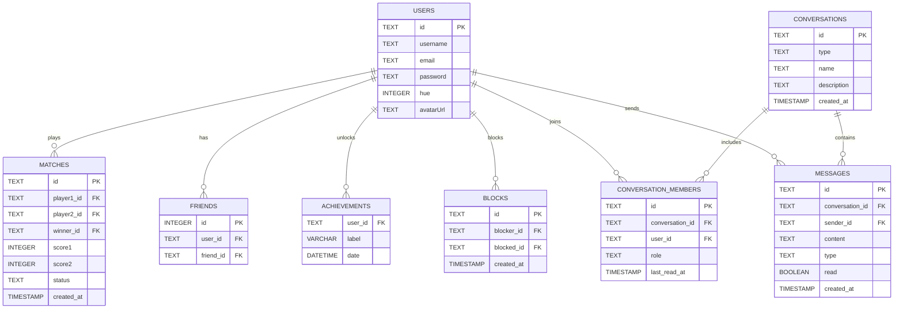

<h1 align="center">🏓 Transcendence</h1>

<p align="center">
  A real-time multiplayer Pong web app with live chat, player stats, leaderboard and spectator mode.<br>
  <em>Final project of the 42 common core.</em>
</p>

<p align="center">
  
  
  
  
  
  
</p>

> **My role — [lsaiti](https://github.com/ksssafcked)**
> I built the real-time layer of the app: the WebSocket engine, online multiplayer synchronization and the live chat.
> See [my contribution](#-my-contribution-the-real-time-layer) for details.

<!-- Optional: add a short gameplay GIF here
<p align="center"></p>
-->

## 📸 Screenshots

<table>
  <tr>
    <td align="center" width="50%">
      <br>
      <sub><b>Player profile</b> — stats, XP level, achievements and match history</sub>
    </td>
    <td align="center" width="50%">
      <br>
      <sub><b>Leaderboard</b> — global player ranking</sub>
    </td>
  </tr>
</table>

## ✨ Features

**🎮 Game**
- Real-time Pong rendered in the browser with canvas
- Remote multiplayer: two players on different devices, synchronized over WebSockets, with disconnect and reconnect handling
- Spectator mode to watch ongoing matches live

**👤 Players**
- Secure sign-up and login (hashed passwords), editable profile and avatar
- Match history, win/loss ratio and global leaderboard
- Progression system: XP, levels and unlockable achievements

**💬 Social**
- Real-time chat: direct messages, group conversations and channels
- Match invitations from the chat, typing indicators and read receipts
- Friends list with live online status, user blocking

## 🔌 My Contribution: the Real-Time Layer

I was the technical lead of the project and was in charge of everything that happens live between players.

**WebSocket engine**
- Designed the WebSocket layer shared by the game, the chat and the presence system
- Event broadcasting for match start/end, invitations and notifications
- Online presence tracking, computed live rather than stored in the database

**Remote multiplayer**
- Synchronization of paddles, ball and score between two players on different devices
- Smoothing of movement updates to keep the game fluid despite network latency
- Handling of disconnections and reconnections during a match

**Live chat**
- Direct messages, group conversations and channels, with persistent history
- Match invitations sent directly from a conversation
- Typing indicators, read receipts and access to user profiles from the chat

**Main challenge:** keeping an online match playable and consistent for both players when the network is unstable, without either side seeing a different game state.

## 🛠️ Tech Stack

| Layer     | Technologies                          |
| --------- | ------------------------------------- |
| Frontend  | TypeScript, Tailwind CSS, HTML Canvas |
| Backend   | Node.js, Fastify, WebSockets          |
| Database  | SQLite                                |
| DevOps    | Docker, Docker Compose, Nginx (HTTPS) |

## 🚀 Getting Started

**Requirements:** Docker ≥ 24 and Docker Compose ≥ 2.20.

```bash
git clone https://github.com/ksssafcked/ft_transcendence.git
cd transcendence
cp .env.example .env   # then fill in the required values
make
```

The app is then available at **https://localhost:8443** (API under `/api`).

## 🗄️ Database

<details>
<summary>Show the database schema</summary>



</details>

## 👥 Team

<!-- Replace the logins with links to each GitHub profile, e.g. [abonnet](https://github.com/username) -->

| Member       | Main contributions                                                                 |
| ------------ | ---------------------------------------------------------------------------------- |
| **lsaiti**   | Technical lead · WebSocket engine, remote multiplayer sync, live chat, presence    |
| **abonnet**  | Pong game frontend and rendering, responsive UI, game statistics, spectator mode   |
| **epasseri** | Fastify backend architecture, authentication, user management, database, friends   |

**Challenges we tackled:** keeping the game loop smooth across browsers, keeping REST and WebSocket events consistent, and handling disconnections and latency in online matches.

## 🤖 AI Usage

AI tools were only used for documentation wording, UI brainstorming and general explanations of technologies. All gameplay, authentication, WebSocket and database code was written and reviewed by the team.
